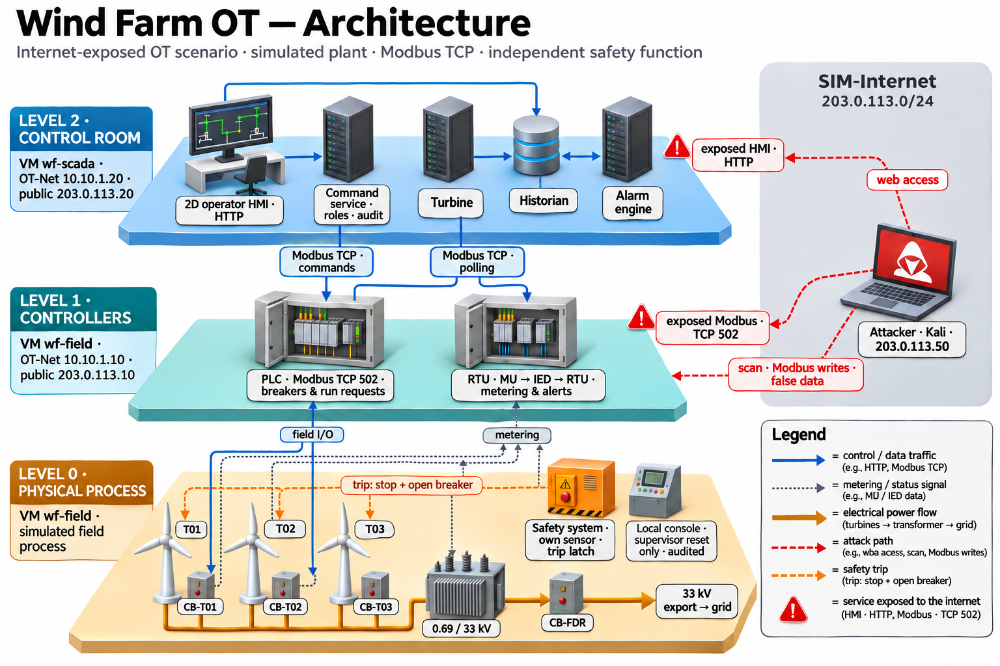
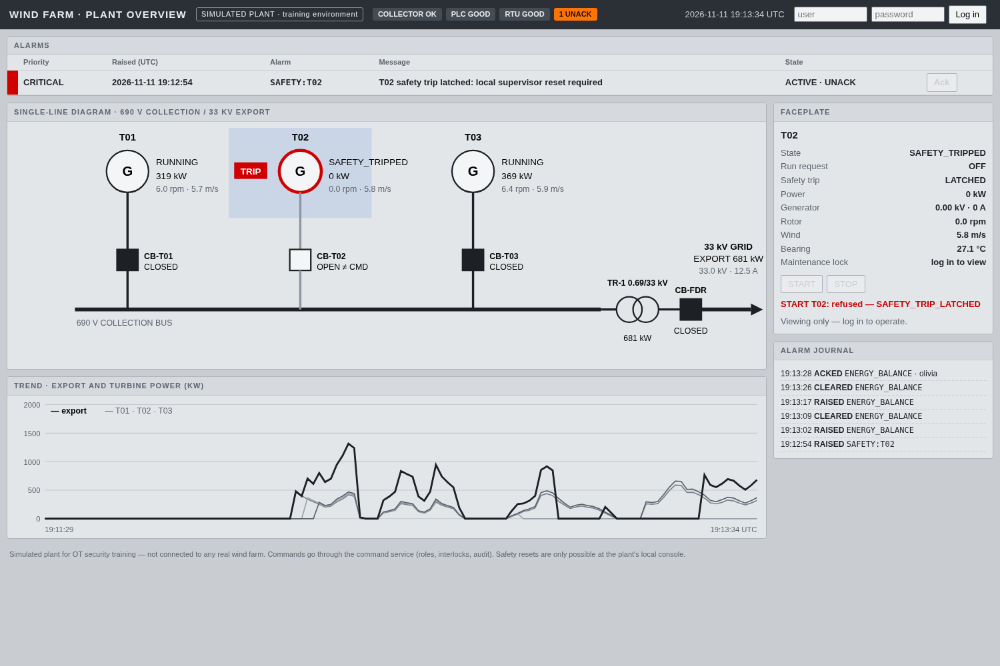

# Wind Farm OT

A simulated wind farm built the way an OT network is: field process, controllers and a control room as separate processes, Modbus TCP between them, and a safety function the control room cannot override. I built it to practise attacking and defending industrial control systems on something closer to a real plant than a single vulnerable service.



This project was inspired by [Power Grid Simulation System](https://github.com/LiuYuancheng/Power_Grid_Simulation_System_Document) by Yuancheng Liu, an OT/ICS cyber-range design for a power grid.

## Two tracks

**Controllable simulated plant.** Three 2 MW turbines driven by real historical weather, each behind a motorised 690 V breaker, feeding a 0.69/33 kV transformer and a 33 kV feeder breaker. Operators can start and stop turbines and switch breakers. This is the track used for attack and defence exercises.

**Historical SCADA replay.** Seven days of measured data from a published Greek wind farm, replayed through a read-only Modbus gateway into a collector, historian and control-room screen. Recorded history can be observed but not commanded, and the two tracks never share data.

## Components

| Level | Component | Role | Default address |
|---|---|---|---|
| 0 | `field_plant` | Turbines (V90/2000 power curve), breakers, transformer, feeder, export meter | UDP `127.0.0.1:15030` (field I/O) |
| 0 | `safety_service` | Child of the field process with its own bearing sensor; a latched trip stops the turbine and opens its breaker | Unix socket (local console) |
| 1 | `plc` | Run requests and breaker closers as Modbus coils; positions, trip latches and turbine states as inputs | Modbus TCP `:15021` |
| 1 | `rtu` | Merging unit → IED → RTU metering table with consistency alerts | Modbus TCP `:15022` |
| 2 | `plant_collector` | Polls PLC and RTU, assigns data quality, writes the historian | — |
| 2 | `alarm_engine` | Alarm rules, debounce, acknowledgement and false-data cross-checks | — |
| 2 | `command_service` | Authenticated commands to the PLC, with roles, interlocks and an audit log | HTTP `:18081` |
| 2 | `plant_hmi` | 2D operator screen: single-line diagram, alarms, faceplates, trends | HTTP `:18082` |

Everything binds to `127.0.0.1` for now. Field I/O and the safety console are deliberately host-local, as they would be inside a turbine or substation cabinet.



*Operator HMI during an exercise: T02 tripped on bearing overtemperature (CRITICAL), and a forged RTU export value raised `ENERGY_BALANCE`.*

## Built-in weaknesses

These are deliberate. They are the attack surface for the exercises, and the table shows what (if anything) notices.

| Weakness | What an attacker can do | Detected by |
|---|---|---|
| PLC accepts unauthenticated Modbus writes | Start, stop and switch breakers directly, bypassing roles, interlocks and the audit log | Nothing in the command audit; the alarm engine sees the resulting breaker states |
| RTU data table is writable (`rtu --reject-writes` hardens it) | Forge power, voltage or breaker positions shown to operators | `ENERGY_BALANCE`, `CROSSCHECK:*` and `RANGE:*` alarms, if the forged values are inconsistent |
| HTTP Basic auth without TLS | Capture operator credentials on the network | Nothing |
| HMI viewable without login | Read plant state and alarms | Nothing |

A forged value that stays consistent with the PLC, the energy balance and physics is not detected. A forged RTU frame must also advance the RTU sequence register, or the collector treats it as a repeat and ignores it.

## Running it

Tested on Linux with Python 3.14.

```bash
python3 -m venv .venv
.venv/bin/pip install -r requirements-dev.txt
```

**Historical replay** (gateway, collector, historian and HMI in one command):

```bash
.venv/bin/python -m scripts.serve_replay
# control room at http://127.0.0.1:18080
```

**Simulated plant.** Create users, then start each service in its own terminal, in this order:

```bash
.venv/bin/python -m scripts.command_service add-user olivia --role operator
.venv/bin/python -m scripts.command_service add-user sam --role supervisor

.venv/bin/python -m scripts.field_plant --scenario-faults
.venv/bin/python -m scripts.plc
.venv/bin/python -m scripts.rtu
.venv/bin/python -m scripts.plant_collector
.venv/bin/python -m scripts.alarm_engine
.venv/bin/python -m scripts.command_service serve
.venv/bin/python -m scripts.plant_hmi
# operator HMI at http://127.0.0.1:18082
```

Users are stored as salted scrypt hashes in `data/runtime/users.json` (mode 0600). Runtime state and historians are written under `data/runtime/` and `data/historian/`, both git-ignored.

In the HMI, log in, click equipment on the single-line diagram, choose an action and confirm it. To energise the plant: close `CB-FDR`, close `CB-T01`–`CB-T03`, then start `T01`–`T03`.

With `--scenario-faults`, faults can be injected over field I/O:

```bash
echo '{"op":"fault","turbine_id":"T02","kind":"overheat"}' | nc -u -w1 127.0.0.1 15030
# kinds: overheat, sensor_failure, overcurrent
```

Supervisor reset at the local console, as the same OS user that runs the plant:

```bash
echo '{"op":"reset","turbine_id":"T02","supervisor":"sam"}' | nc -U -q1 data/runtime/local_console.sock
```

## Tests

```bash
.venv/bin/python -m pytest tests -q
```

The suite covers the field process, PLC and RTU, collector, command service, alarm engine and HMI. Most integration tests start real processes and talk real Modbus TCP and HTTP. A full run takes about three minutes on a Raspberry Pi 5.

## Repository layout

```
scripts/            all services and tools (run as python -m scripts.<name>)
web/                plant_hmi.html (operator HMI), control_room.html (replay screen)
tests/              pytest suite
data/raw/           source extracts: Greek SCADA slice, Tarfaya weather
data/derived/       model and scenario outputs
docs/img/           architecture diagram and HMI screenshot
architecture.md     design notes and per-component details (register maps, rules, lifecycle)
sources/links.md    data provenance and references
```

## Data and attribution

- **Measured SCADA data:** Ntafalias, Visvardi & Weißenfeld, *Six-Month Monitoring Dataset from a 10-Turbine Onshore Wind Farm in Greece* (2024), [doi:10.5281/zenodo.14546480](https://doi.org/10.5281/zenodo.14546480), CC BY 4.0. The repository contains a three-turbine, seven-day extract (5–11 February 2020) with values unchanged. The source does not state its timezone, so timestamps are kept as published.
- **Weather:** [Open-Meteo](https://open-meteo.com/) historical reanalysis for a grid point near Tarfaya, Morocco, 1–7 January 2024, CC BY 4.0. It is modelled weather, not turbine-site measurement.
- **Power curve:** Vestas V90/2000 from the OpenEnergy Database via [windpowerlib](https://github.com/wind-python/windpowerlib).

Full provenance, including file hashes, is in [`sources/links.md`](sources/links.md).

## Status

The plant, controllers, collector, alarm engine, command service and HMI are implemented and tested. Work in progress:

1. **3D visualisation.** I'm currently exploring a 3D view of the wind farm that shows the simulated plant state in real time.
2. **VM deployment.** Configurable bind addresses, systemd units and an install script for two Ubuntu VMs: `wf-field` (Levels 0–1) and `wf-scada` (Level 2). The target is an isolated `10.10.1.0/24` OT network and a simulated internet on `203.0.113.0/24` with no real uplink.
3. **Attack runbook.** Reconnaissance, Modbus writes that bypass the command service, RTU false-data injection and credential capture, each with the evidence it should and should not produce.
4. **Hardening comparison.** Host firewall rules and `rtu --reject-writes`, measured against the same attacks.

I'm learning OT by building this project. If something here is wrong or unrealistic, please [open an issue](https://github.com/YoussefKHouya/wind-farm-ot/issues) so I can correct it.
