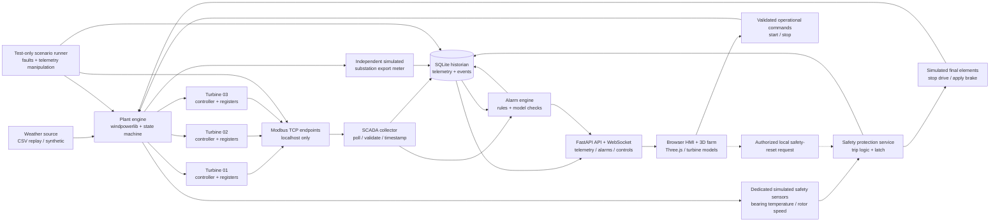

# Wind Farm OT/SCADA Simulator — Architecture v1

**Purpose:** A self-contained, offline-capable personal OT/offensive-security project for wind-farm control, monitoring, and safety-boundary testing, inspired by the operational setting of Moroccan wind farms. It is not a model of a real operator's actual systems, turbine configuration, protocols, or security posture.

## System boundary and architecture

**Trust boundaries:** The plant engine's internal state is the simulation's ground truth; the Modbus-visible register values are untrusted observations. The safety protection service gets its own simulated sensor feed, not the SCADA/Modbus display value, and takes precedence over ordinary control commands. Software-process separation demonstrates an interface boundary, NOT physical redundancy or a certified SIS. The export meter is simulated separately from the turbine telemetry path, but is NOT a real independent physical meter. The anomaly detector must compare observations, model estimates, and quality/status flags; a model residual alone does not prove a cyberattack. The scenario runner is test-only, never mounted into the normal operator controls. No network connection to a real turbine, operator asset, or corporate environment.

## How the turbines are simulated

Each turbine is a **software state machine plus an engineering approximation**, not a spinning 3-D model. At each simulation tick, read a wind-speed/ambient-temperature sample (offline weather CSV or seeded synthetic trace); optionally perturb each turbine's wind speed slightly so the three do not produce identical outputs. Use `windpowerlib` with a documented generic turbine power curve to compute potential electrical output for each weather sample. Apply operating state (stopped, running, curtailed, high-wind cutout, faulted, safety-tripped) to obtain actual simulated production. Simulate rotor-speed response and component temperatures with deliberately simple, documented dynamic rules: heating depends on load/rotation and fault state, cooling depends on ambient temperature and elapsed time. Publish controller telemetry through Modbus, but publish dedicated simulated safety-sensor readings via a different channel. On a safety trip, the safety service commands the plant to stop production and apply a simulated brake; plant state persists as tripped until allowed reset. The export meter computes total delivered output from actual plant state, not the potentially forged SCADA register values.

Tick order: `weather -> potential power -> controller state/loads -> rotor and thermal state -> safety sensor -> safety decision and actuator -> actual output -> meter -> SCADA telemetry`. The simulator records ground truth for evaluation; SCADA/detector never reads it directly. The temperature dynamics and rotor response are **educational approximations**, not validated OEM/physics models. We will verify invariants: no negative output; no power when stopped/tripped; capped at rated power; temperatures respond directionally to heat/cooling; safety trip takes priority over start; identical seed/input gives identical replay.

### 3-D visual twin

This project **does have a 3-D way**: render a wind farm in the browser with Three.js. Model one low-poly turbine (tower, nacelle, three-blade rotor) in Blender, export GLB, instantiate it three times, and attach each scene object to the corresponding turbine ID. The browser animates blade rotation from the reported rotor RPM; stop/brake visibly slows it, and trip/fault changes lights/overlays and raises an alarm panel. Show wind direction/strength and time-of-day as optional visuals. Clicking a turbine opens its SCADA details and history. FastAPI streams reported telemetry over WebSocket; the 3-D scene is a *visualization of the observer's view*, not the physics or safety engine. During an attack it may animate an incorrect reported state; a separate evidence view compares that with simulated truth only after/within an evaluation run. 3-D assets have local licenses/provenance and are bundled for an offline demo.

## Components and responsibilities

| Component | Responsibility | MVP implementation |
|---|---|---|
| Weather source | Replay time-indexed wind data or generate deterministic test winds; normalize to m/s and UTC | CSV + Python adapter; synthetic fixtures bundled |
| Plant engine | Compute expected power from turbine power curves, update turbine states, aggregate farm output; simulate ambient and component temperatures | Python + windpowerlib; 3 turbines |
| Turbine controller | RUNNING, STOPPED, FAULT, HIGH_WIND_CUTOUT; command/state transitions; telemetry | Python state machine per turbine |
| Telemetry endpoints | Expose read-only measurements/status to collector through Modbus TCP | PyModbus; 1 simulated endpoint per turbine on loopback high ports |
| SCADA collector | Scheduled reads; timestamps, units, sequence/quality; timeouts do not become zero measurements | Python worker, e.g. 1-second simulation ticks |
| Export meter | Separately publish simulated total delivered power; apply availability/curtailment | In-process model, separate data channel to historian |
| Historian | Keep timestamped samples, commands, faults, and alarms | SQLite in WAL mode; simple repository layer |
| Alarm engine | Deterministic rules: offline/stale, high wind, temperature, power mismatch, meter mismatch | Python rules with debounce, hysteresis, recovery, and acknowledgment |
| Safety protection subsystem | Dedicated simulated safety sensor -> independent trip logic -> stop/brake final element; latched trip with restricted reset | Separate Python process/module and private simulated sensor channel; trip has precedence over control |
| Web/API gateway | Read-only telemetry/history stream plus validated control endpoints; server-side role checks and audit | FastAPI REST + WebSocket, scoped to project interface |
| HMI and 3-D farm | Interactive scene with three turbines, operator panels, trends, safety-trip and alarms | Three.js web UI; custom Blender glTF/GLB turbine mesh or a licensed bundled asset |
| Command service | Validate operational start/stop requests, record actor/time/result, pass to plant engine; reject starts while safety trip is latched | Local Python service; no Modbus writes from HMI; separate restricted safety-reset workflow |
| Scenario runner | Named, repeatable cases for normal, mechanical fault, sensor drift, forged power register, comms outage | Test harness with seed and start/end markers |

## Main data and control flows

1. Input weather sample -> normalize to m/s and UTC -> plant engine computes estimated output using the turbine power curve. The initial data is Open-Meteo historical **reanalysis** for a grid point near the town of Tarfaya (2024-01-01 through 2024-01-07, hourly), not measurements from a wind farm; the representative power curve is windpowerlib/OEDB `V90/2000`, not an claim about any real site's turbines.
2. Turbine controller applies availability, high-wind cutout, fault and curtailment rules -> actual simulated output and state.
3. Turbine telemetry is encoded as Modbus register values; collector polls each endpoint, decodes/scales data, and writes observations to historian. Loss of communication sets BAD/STALE quality, not a fabricated 0 W value.
4. Simulated substation meter sends aggregate exported power on a separate internal channel. The alarm engine compares individual reported output with model expectations *and* aggregate meter output, allowing tolerance/debounce and explicit fault/curtailment context.
5. HMI reads persisted data and displays current state, alarms, trips, trends, and a scenario timeline. Operational HMI commands go through command service and affect the controller only after validation; they cannot bypass a safety trip. Safety reset is a separate authorized local workflow; all attempts are logged.
6. Scenario runner can modify plant truth for faults or alter only telemetry publication for false-data cases. Each run records its expected labels for evaluation.

## Example telemetry contract (design, not vendor register map)

Per-turbine fields: `turbine_id`, `timestamp_utc`, `wind_speed_mps`, `ambient_temp_c`, `bearing_temp_c`, `generator_temp_c`, `rotor_rpm`, `active_power_kw`, `availability`, `operating_state`, `fault_code`, `quality`. Values are scaled to unsigned 16-bit Modbus registers (for example wind speed m/s times 10, power kW as integer); map, ranges, endianness, sentinel values, and unit-ID/port assignments will be versioned in one explicit register-map file before implementation. Negative/signed values and values beyond 16-bit range require specified encoding, not implicit casts.

### Temperature monitoring versus safety protection

Ambient temperature is weather context; bearing and generator temperatures are equipment-health signals. A `30 C` threshold can be used as a **demonstration-only ambient-temperature alert**, but it must not be represented as a real turbine overheat limit. SCADA may generate a warning from its own telemetry; that warning is NOT the safety function. A dedicated simulated bearing-temperature input feeds a separate safety protection service, which compares to a documented **simulation-only** trip setpoint, latches a trip, and commands a simulated stop/brake regardless of HMI or SCADA availability. The HMI displays the resulting trip status and records the event; acknowledgment never resets or bypasses it. Reset requires restored safe conditions, a separate authorized local-reset action, and a logged decision. Define `>` vs `>=` explicitly in the safety-function tests. No vendor setpoint, actual safety integrity level (SIL), or standards compliance is claimed.

**Safety-function contract (SIF-01, simulation):** hazard = overheating bearing while rotating; input = dedicated valid safety-channel bearing temperature; trip condition = above configured simulation trip setpoint; action = stop turbine generation and apply simulated brake; safe state = turbine stopped with `SAFETY_TRIPPED` latched; reset conditions = input valid and below configurable reset setpoint, plus authorized local reset. For missing/invalid safety input, choose and document a conservative simulated behavior rather than silently treating it as zero; test both sensor-fail and common-cause sensor scenarios. HMI start/stop commands cannot override `SAFETY_TRIPPED`, and forged SCADA/Modbus telemetry cannot prevent a valid safety-channel trip. The same plant engine still simulates both channels' physical effects: this is logical separation for education, not hardware independence.

Historian records: `raw_observations`, `plant_truth` (project-only evaluation, not shown as live detector input), `meter_samples`, `alarms`, `commands`, `scenario_runs`. Every event carries a UTC timestamp and scenario/run ID. `plant_truth` is visible to the evaluator but not the production detection rules.

## Test scenarios and expected observations

| Scenario | Simulation condition | Expected system behavior |
|---|---|---|
| Baseline | Wind varies; all turbines healthy | Power follows curves within tolerance; no security alert |
| Ordinary stop / curtailment | Authorized command or control rule limits one turbine | HMI state and audit log show intent; no false cyber alert |
| Mechanical fault | One turbine transitions to FAULT while wind remains suitable | Operational alarm; distinguish from telemetry tampering |
| Hot component | Bearing temperature crosses a configured SCADA warning threshold and then the separate safety trip setpoint | Warning is visible; safety channel latches trip and actuates stop/brake independently of HMI |
| Hot ambient day | Ambient temperature exceeds 30 C while components stay healthy | Optional weather notice, no turbine-overheat or cyber alarm |
| Temperature sensor outage | Bearing-temperature reading becomes stale or invalid | Sensor-quality alert; no comparison against zero or stale temperature |
| Safety sensor failure | Safety channel reading is missing or invalid | Documented conservative simulated response, separate diagnostic event, no silent bypass |
| Forged SCADA temperature | SCADA register reads cool while dedicated safety sensor is hot | Safety protection still trips; HMI reports mismatch when evidence arrives |
| HMI unavailable / restart attempt | Dashboard is down or start command is issued after safety trip | Trip remains latched; start denied until safe authorized reset |
| High wind cutout | Wind exceeds selected curve's operating envelope | All affected turbines stop safely; no false attack alert |
| Forged production | Published power for turbine 02 is modified while plant truth and export meter remain unchanged | Cross-check flags sustained discrepancy; alert with evidence |
| Communications loss | Turbine endpoint unavailable | Stale/offline alarm, missing-quality marker; never interpret as zero generation |
| Sensor drift | Published wind speed slowly deviates | Model-residual warning only when sustained; report possible benign causes |

## Detection and measurement

- Rule A: loss of communications or stale values after configured missed polls.
- Rule T (SCADA): over-temperature warning on valid component telemetry only, with configurable warning limits, persistence, hysteresis and acknowledgment; optional ambient-temperature notice is separate. **Safety trip (SIF-01) runs outside this alarm engine.**
- Rule B: turbine power vs power-curve estimate outside a tolerance over a configurable window, with state, cutout, fault, and curtailment exemptions.
- Rule C: sum of reported turbine power vs independently transported export-meter value outside tolerance over a window. Meter is *simulated*, not proof of real-world tamper resistance.
- All thresholds are measured/tuned against normal replay data; do not pick a single unexplained constant and call it validated.
- Report time-to-alert, false-positive count/rate on benign scenarios, missed detections, and evidence fields for each run. Label fault, weather, and tamper separately.

## Offensive-security evaluation track

**Question:** Can an attacker with access to the simulated supervisory/telemetry network falsify the operator's view, issue unauthorized control actions, or cross the separate safety boundary? We must distinguish a compromised HMI, a stopped turbine, and a suppressed safety trip; these are different outcomes.

**Assets and boundaries:** Turbine availability, integrity of operational commands, HMI telemetry, safety sensor input, safety trip decision, and trip actuator. Red begins at an attacker-controlled client on the isolated Modbus/HMI project segment. The safety service and its private sensor channel are out of reach at this starting capability. Each exercise states its attacker capability (network-only, stolen operator role, or later privileged host compromise) before testing; never grant access by modifying the plant's ground-truth internals as a shortcut.

| Exercise | Realistic injection point in our project | Objective and proof | Expected safe result |
|---|---|---|---|
| Telemetry manipulation | Bounded forged/stale Modbus-visible values via an isolated test proxy/endpoint | Make HMI show false production/temperature; capture raw vs displayed values and detector timeline | Alarm on inconsistency; safety trip still follows private safety input |
| Command authorization | Normal HMI/control-service request path with wrong role or replayed command | Show whether unauthorized start/stop is rejected; verify command log and turbine state | No state change on unauthorized request; authorized workflow still works |
| Control-versus-safety conflict | Valid operational start after a safety trip | Try to start despite latched trip; observe service response and final state | Start denied until safe, logged local safety reset |
| Supervisory outage | Stop collector/HMI or drop project telemetry flow | Attempt to blind operator while turbine condition changes | Stale/offline diagnostic; independent safety trip remains operative |
| Advanced safety-boundary test | Deliberate fault injection in the separate simulated safety sensor/logic interface, **only after** baseline is proved | Demonstrate exactly which additional access would be needed to inhibit a trip; log sensor, decision, and actuator state | If the boundary fails, record it as an actual project finding with conditions, then fix and rerun |

**Evidence contract per run:** initial role/access, packet or command trace, timestamps, pre/post turbine state, HMI view, safety sensor value, safety logic decision, actuator state, relevant logs, and exact pass/fail result. Include at least one benign case per attack class to expose false positives. Do not describe a forged HMI value alone as SIS compromise. For advanced scenarios, a test-harness shortcut that writes directly to safety state is not an exploit; it is only a fault-injection control unless a reachable path from the defined attacker position is proved.

**Isolation controls:** Host-only VM network or isolated container network only, synthetic data and assets, unprivileged ports, no routing or scanning to actual wind farms or vendor systems. Do not present this Python demonstrator as physical fail-safe hardware or certify its safety integrity.

## Implementation stages and gates

1. **Model contract and fixtures:** define turbine curve, CSV/weather schema (including ambient temperature), units, component-temperature model, time acceleration, state transitions, safety input and trip/reset contracts. Gate: deterministic replay and power/state/temperature/safety-transition unit tests.
2. **Plant simulator + safety loop:** three turbine instances plus aggregate export meter; dedicated simulated safety sensors, trip solver and stop/brake action. Gate: healthy, fault, stop, cutout, hot-bearing trip, failed sensor and denied restart cases reproducible from seed.
3. **OT telemetry:** Modbus map/server and separate collector. Gate: decoded values match published values; outage marks stale, not zero.
4. **Historian + API + functional 2-D HMI:** tabular fleet overview, turbine detail, temperature/power trends, warning/trip status, alarm timeline, authorized reset workflow and command audit. Gate: end-to-end normal run, overheating trip, recovery, stale-sensor behavior and persistence; verify in a real browser. Keep a stable turbine-ID, state, RPM and telemetry API contract so a later 3-D client consumes the same data.
5. **Offensive-security scenarios + detection:** attack actual project protocol/control interfaces; include benign fault/curtailment controls and the safety-boundary tests. Gate: capture request/packet and state evidence, demonstrate both detected and undetected outcomes honestly, tune false positives, and rerun after fixes.
6. **Reproducible local packaging:** one-command startup for the local Python services, sample data, full scenario replay and machine-readable test results. Gate: clean installation and reproduction offline. An isolated two-VM target/attacker deployment is **optional later**, when testing network attacks from a distinct host is useful; it is not needed for initial simulation or safety-loop development.
7. **3-D visual twin (final milestone):** Blender turbine GLB and Three.js wind-farm control-room view consume the existing FastAPI/WebSocket feed; no replacement of physics, collector or safety logic. Gate: blade RPM and stop/brake visuals match reported state, historical replay works, clicking a turbine shows live SCADA details, and the forged-telemetry scenario visibly differs from recorded ground truth in the evaluation view.

## Deployment and guardrails

**Development now:** Run local Python scripts on the Pi. A second local Python process can model a logically separate safety service when that stage is built; no VM, Docker Compose, or Kali installation is needed for the current offline baseline. Distinct processes on one machine are not physical safety independence. **Optional later offsec project on an x86 laptop:** VirtualBox with an Ubuntu Server target VM and a separate Kali attacker VM on a host-only network; the wind-farm services can run inside Ubuntu and expose only selected project interfaces to Kali. Use VM snapshots before experiments and avoid bridged networking. A Pi-native Docker deployment is another later option but shares the host kernel. Never assume an x86 Kali VM runs natively on an ARM64 Pi. CSV fixtures and a local browser make the baseline offline-capable. Avoid proprietary operator data, logos, plant topology, or any assertion this is its actual infrastructure.

**Current executable slice:** `<project root>` contains source-weather retrieval, real historical reanalysis CSV, the windpowerlib three-turbine **offline baseline**, a simulated overheat/trip case, and tests. It does **not** yet contain running Modbus, a separate safety process, VM images, SCADA, attack paths, or 3-D visualization; those remain milestones. The current trip is an in-process model rule and must not be presented as an independently deployed SIS.

## Evidence behind tool selection

- windpowerlib ModelChain supports weather-to-turbine power output and custom turbine power curves: https://windpowerlib.readthedocs.io/en/stable/modelchain_example_notebook.html
- PyModbus offers async TCP server endpoints: https://pymodbus.readthedocs.io/en/latest/source/server.html
- Three.js GLTFLoader supports loading a GLB turbine asset: https://threejs.org/docs/pages/GLTFLoader.html
- FastAPI WebSockets support live reported telemetry updates to the browser: https://fastapi.tiangolo.com/advanced/websockets/
- Blender's glTF exporter supports creating a bundled turbine asset: https://docs.blender.org/manual/en/latest/addons/import_export/scene_gltf2.html
- Open-Meteo Historical Weather API supports 100 m wind speed and unit selection; optional weather data source, not needed for offline demo: https://open-meteo.com/en/docs/historical-weather-api
- IEC 61400-1 covers wind-turbine control and protection subsystems: https://webstore.iec.ch/en/publication/26423
- IEC 61511-1 specifies SIS requirements for the process-industry sector, not an automatic compliance claim for this wind-turbine demo: https://webstore.iec.ch/en/iec_catalog/product/preview/?id=L3B1Yi9wZGYvcHJldmlldy9pbmZvX2llYzYxNTExLTF7ZWQyLjB9Yi5wZGY%3D
- IEC 61508 addresses general E/E/PE functional safety (software requirements shown here): https://webstore.iec.ch/en/publication/5517
- MITRE ATT&CK for ICS describes adversary behaviors such as manipulation of the operator view and inhibition of response functions: https://attack.mitre.org/matrices/ics/
- NIST SP 800-82 Rev. 3 provides OT security guidance and distinguishes safety/reliability constraints: https://csrc.nist.gov/pubs/sp/800/82/r3/final
- Docker Compose supports `internal: true` networks without external connectivity: https://docs.docker.com/reference/compose-file/networks/
- libvirt supports QEMU/KVM guests when a usable KVM device and emulator are available: https://libvirt.org/drvqemu.html
